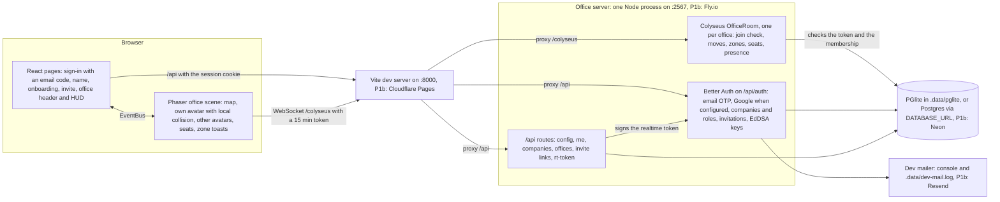

# Virtual Office

Virtual Office is a virtual office in the browser for remote teams.
Each person has an avatar on a 2D map of the company's office. People walk around, sit at desks and see each other move.
Later phases add chat, proximity video, a meeting-room call, screen share and a whiteboard.

The client uses Phaser 4 for the map and React 19 for the pages and the HUD. Vite 8 builds the client.
The office server runs Express 5 with Better Auth (accounts, companies, invitations) and Colyseus 0.18 (one realtime room per office) on one port.
Data lives in PGlite (Postgres in WebAssembly) on your machine, or in Postgres in production. TypeScript 6 checks the code.

## Requirements

- Node.js 22.18 or a newer 22.x, Node.js 24, or Node.js 26 or newer. We recommend Node.js 24 (see `.nvmrc`).
  Node.js 23 and 25 are not supported.
- npm 11 or newer. Node.js 24 comes with npm 11. On Node.js 22, run `npm install -g npm@11` first.
  npm 10 rewrites `package-lock.json` in its own format.

Node.js 22.18 and newer run TypeScript files directly (type stripping). The server and some scripts use this; they have no build step.

You need no accounts, no database and no Docker for development.

## Run it locally

1. Clone the repository and go to its folder.
2. Install the packages:

   ```bash
   npm install
   ```

3. Start the office server (port 2567) and the client (port 8000) together:

   ```bash
   npm run dev
   ```

4. Open http://localhost:8000. You land on the sign-in page.
5. Enter any email address and click **Email me a code**. No mail is sent in development:
   the server prints the mail with the 6-digit code in its console (the `server` lines of `npm run dev`) and appends it to `.data/dev-mail.log`.
6. Enter the code. A new email gets an account; you then choose the name that shows above your avatar.
7. Create your company and its office. You are its owner and you enter the office.
8. Walk with the arrow keys or WASD. Press E near a seat to sit down, and E again to stand up.
9. To meet someone, click **Copy invite link** (as Member or Guest) and open the link in another browser or a private window.
   Sign in there with another email address, join, and you see each other walk and sit.
   A link from the header works for 3 days and 10 people. **Links** lists the open links; **Revoke** ends one.

The data stays in `.data/` (PGlite in `.data/pglite`). Delete the folder to start again with an empty database.

To try the office without the server, open http://localhost:8000/dev/office. It is a mock office with fake players, in development builds only.

## Architecture (P1)



The server is the authority. The client moves its own avatar at once (Arcade physics with a 20 x 12 px body at the feet) and sends its position 10 times a second.
The room checks every move (speed, a swept body against walls and furniture, zone rules) and answers a bad one with `move:reject` and the last accepted position; the client snaps back there.
Zones, seats and presence come from the synced room state, so every client shows the same thing.

## Scripts

Run each script from the repository root with `npm run <name>`.

| Script         | What it does                                                                                                   |
| -------------- | -------------------------------------------------------------------------------------------------------------- |
| `dev`          | Starts the office server (port 2567) and the client (port 8000) together.                                      |
| `dev:server`   | Starts only the office server. It restarts when a file changes and reads `apps/server/.env` if it exists.      |
| `dev:client`   | Starts only the client. Vite sends `/api` and `/colyseus` to the office server.                                |
| `start`        | Starts the office server without the file watcher. Set `NODE_ENV` first (the server refuses to start without it). |
| `build`        | Builds the client into `apps/client/dist`, then starts and stops the server once under plain Node (see below). |
| `preview`      | Serves the built client on port 8000.                                                                          |
| `typecheck`    | Checks the types in all workspaces, the tests and the e2e tests.                                               |
| `lint`         | Runs ESLint. A warning also makes it fail.                                                                     |
| `test`         | Runs all unit and integration tests one time with Vitest (shared code, client, database, HTTP API, office room). |
| `e2e`          | Runs the Playwright tests in `e2e/` with their own server and client (see [Tests](#tests)).                    |
| `db:generate`  | Writes a new SQL migration to `packages/db/drizzle` from the Drizzle schema.                                   |
| `validate:map` | Checks the office map file (`map.json`) against the map rules.                                                 |
| `check`        | Runs `typecheck`, `lint`, `test`, `validate:map` and `build`.                                                  |

Run `npm run check` before you push. GitHub Actions runs the same steps on each push to `main` and on each pull request, and then the e2e tests.

The server has no build output: Node runs `apps/server/src` as it is. So its `build` step (`apps/server/scripts/smoke.ts`) starts it once with an in-memory database and stops it again.
That fails on syntax Node cannot strip and on imports Node cannot resolve, which `tsc` and Vitest would let through.

## Folder structure

```
.
├── apps/
│   ├── client/                 Browser client (@vo/client)
│   │   ├── index.html          Vite entry page
│   │   ├── public/assets/map/  Tiled map (map.json) and tileset images
│   │   ├── src/
│   │   │   ├── main.tsx        React entry point
│   │   │   ├── App.tsx         Picks the page for the current route
│   │   │   ├── router/         A small History API router (the routes are CLIENT_ROUTES in @vo/shared)
│   │   │   ├── api/            Better Auth browser client, /api requests, the realtime token kept in memory
│   │   │   ├── pages/          Sign-in, name, onboarding, invite and accept-invitation pages
│   │   │   ├── office/         The office page: header, connection state, the dev mock page /dev/office
│   │   │   ├── net/            The room link (Colyseus) and the mock office
│   │   │   ├── hooks/          Small React hooks
│   │   │   ├── ui/             React HUD (zone label, seat hint, toasts, debug hint)
│   │   │   └── game/
│   │   │       ├── EventBus.ts       Typed events between React and Phaser
│   │   │       ├── PhaserGame.tsx    Creates and destroys the Phaser game
│   │   │       ├── config.ts         Phaser game settings
│   │   │       ├── cameraFit.ts      Camera zoom: follow zoom, or the whole map
│   │   │       ├── depth.ts          Draw order of the tile layers, avatars and debug overlay
│   │   │       ├── readOfficeMap.ts  Parses and validates map.json with @vo/shared
│   │   │       ├── obstacles.ts      Static Arcade bodies from the Collision layer
│   │   │       ├── zoneHover.ts      Zone under the mouse, sent to the HUD
│   │   │       ├── seats.ts          Nearest free seat and the seat hints
│   │   │       ├── zoneToast.ts      'Entered Meeting room (group call later)'
│   │   │       ├── avatar/           Placeholder avatars drawn by code (one module, to swap for real art)
│   │   │       ├── player/           Own avatar: input, local physics, moves sent to the server
│   │   │       ├── remote/           Other avatars, smoothed with a 200 ms buffer (two patches)
│   │   │       ├── session/          The connected office in the scene, presence reports
│   │   │       ├── debug/            Map debug overlay
│   │   │       └── scenes/
│   │   │           └── OfficeScene.ts  Builds the office from the map
│   │   └── vite.config.ts      Dev server on port 8000 with the proxy to the office server
│   └── server/                 Office server (@vo/server): Express, Better Auth and Colyseus on one port
│       ├── .env.example        Optional local settings (copy to apps/server/.env)
│       ├── scripts/smoke.ts    The build step: start and stop under plain Node
│       ├── src/
│       │   ├── index.ts        Entry point: reads the environment and starts the server
│       │   ├── dev.ts          npm run dev: reads apps/server/.env if it exists, then runs index.ts
│       │   ├── env.ts          Environment variables, checked with zod
│       │   ├── server.ts       Wires the database, auth, HTTP routes and the office room
│       │   ├── auth/           Better Auth, roles, realtime token check, office access with a cache
│       │   ├── mail/           Sign-in codes and invitations (Resend; console and log file in dev)
│       │   ├── http/           The /api routes
│       │   └── rooms/          OfficeRoom (one Colyseus room per office), its synced state and its store
│       └── test/               HTTP tests (real auth on PGlite) and room tests (real Colyseus clients)
├── packages/
│   ├── db/                     Database (@vo/db): Drizzle schema, migrations, PGlite or Postgres
│   │   ├── src/schema/         Tables (auth.ts is generated by the Better Auth CLI, product.ts is ours)
│   │   ├── src/repository.ts   forOrg(db, orgId) and forUser(db, userId): every query names its company or user
│   │   └── drizzle/            SQL migrations, applied when the server starts
│   └── shared/                 Code for the client and the server (@vo/shared)
│       ├── src/
│       │   ├── officeMap.ts    parseOfficeMap: Tiled JSON to an OfficeMap
│       │   ├── zones.ts        zoneAt and ZoneTracker (zone changes with hysteresis)
│       │   ├── grid.ts         Collision grid, line of sight, reachability
│       │   ├── validate.ts     validateOfficeMap: the map rules
│       │   ├── movement.ts     Server move checks: speed, swept body, move budget, zone entry, stand-up spot
│       │   ├── protocol/       Realtime messages, synced state shape and HTTP API (zod schemas)
│       │   └── cli/validate-map.ts  The validate:map command
│       └── test/
├── e2e/                        Playwright tests: two browsers in one office, and an outsider
├── .github/workflows/ci.yml    Continuous integration: check, then e2e
├── CREDITS.md                  Art credits and license notes
├── eslint.config.js
├── playwright.config.ts        Starts the e2e server and client
├── tsconfig.base.json          TypeScript settings for all workspaces
└── vitest.config.ts
```

The repository uses npm workspaces. Each folder in `apps/` and `packages/` is a workspace.
No workspace has a build step except the client. Node.js runs the server's TypeScript files directly (type stripping), and Vite reads `@vo/shared` directly.
So the code uses only erasable TypeScript syntax: no enums, no namespaces, no parameter properties and no decorators. Relative imports name the `.ts` file.

The design plan asked for a pnpm 12 workspace. We use npm workspaces on purpose:
npm comes with Node.js, so you and CI need no other tool and no extra setup step.
The folder layout is the same as with pnpm. A later move to pnpm needs only a new lockfile, the CI setup and the `--workspace` flags in the scripts.

## Office server

`apps/server` runs Express (the Better Auth routes under `/api/auth` and the other `/api` routes) and Colyseus on one HTTP server, port 2567.
In development the browser talks only to http://localhost:8000. Vite forwards `/api` to the server (with `X-Forwarded-For`), and `/colyseus` (matchmaking and the WebSocket) without the `/colyseus` prefix.

### Environment variables

`NODE_ENV` is always required (`npm run dev`, the tests and the e2e run set it), so a server never falls back to the development settings by mistake.
In development every other variable is optional. In production (`NODE_ENV=production`) the server refuses to start without the required ones, and it never prints or logs mail.

| Variable                                   | Development and tests                                    | Production                                                                 |
| ------------------------------------------ | -------------------------------------------------------- | -------------------------------------------------------------------------- |
| `NODE_ENV`                                 | Required: `development` (`npm run dev` sets it; tests: `test`) | Required: `production`                                               |
| `PORT`                                     | `2567`                                                   | The port the host gives.                                                   |
| `CLIENT_ORIGIN`                            | `http://localhost:8000`                                  | Required: the public origin of the client. Only it may call the API with cookies, and invite links point to it. |
| `BETTER_AUTH_URL`                          | `CLIENT_ORIGIN`                                          | Required: the public origin of `/api/auth`. Also the issuer of the realtime token. |
| `BETTER_AUTH_SECRET`                       | A fixed development value                                | Required: at least 32 characters, not the development value.               |
| `DATABASE_URL`                             | Unset: PGlite                                            | Required: a Postgres connection string.                                    |
| `DATA_DIR`                                 | `.data` (from the repository root)                       | Not used.                                                                  |
| `PGLITE_DIR`                               | `DATA_DIR/pglite` (tests: `memory://`)                   | Not used.                                                                  |
| `RESEND_API_KEY`                           | Unset: mail goes to the console and `DATA_DIR/dev-mail.log` | Required: mail goes out through Resend.                                 |
| `EMAIL_FROM`                               | `Virtual Office <office@localhost>`                      | Required: a sender on a domain verified in Resend.                         |
| `GOOGLE_CLIENT_ID`, `GOOGLE_CLIENT_SECRET` | Unset: no Google button                                  | Optional. Google sign-in is on only when both are set.                     |
| `MAP_PATH`                                 | `../client/public/assets/map/map.json` (from `apps/server`) | The same file, unless you ship the map elsewhere.                       |

Put local values in `apps/server/.env` (see `apps/server/.env.example`). The file is not committed.
`npm run dev` reads it at start (restart it after a change); `npm start` does not.

The client reads two more variables. `VITE_SERVER_URL` (unset in development) is the server's own origin when it does not share the client's origin (P1b).
`OFFICE_SERVER_URL` changes where the Vite dev proxy sends `/api` and `/colyseus` (default `http://127.0.0.1:2567`); the e2e run uses it.

### Accounts and companies

- Sign-in is by email code: 6 digits, valid for 5 minutes, stored hashed. A new email gets an account at its first sign-in. There are no passwords.
  Google sign-in appears when both Google variables are set (`GET /api/config` tells the client).
- A company is a Better Auth organization with one office from the `startup-hq-40x30` template. Its creator is the owner.
  Companies are created only through `POST /api/companies` (Better Auth's own `/organization/create` is off), at most 3 per owner.
  Roles: owner, admin, member and guest. Guests may enter only the lobby and the meeting room (an office setting can change the list).
  A member has exactly one of these roles: Better Auth refuses role lists such as `member, owner` or `owner ` (hooks in `auth.ts`).
- Owners and admins create invite links (member or guest, 7 days and no use limit by default, 3 days and 10 people from the header; the server stores
  only a hash of the token) and email invitations (48 hours). `GET /api/offices/:id/invite-links` lists the open links and
  `DELETE /api/offices/:id/invite-links/:linkId` revokes one (the **Links** panel in the header).
- Removing a member (Better Auth `remove-member`) records the removal: no invite link lets that person back in (403 `removed`), only an
  email invitation that they accept. The links that a removed member, or a member who left, had created are revoked.
- Guests cannot read the member list, the pending invitations or the full company (403 from `list-members`, `list-invitations` and
  `get-full-organization`); the room shows them only names.
- Names (yours, a company's, an office's) are 1 to 80 characters on one line. Invitation mails leave links and line breaks out of the names
  in them, and go out at most 3 times per company and address and 20 times per inviter in 24 hours (resends included), and 10 times a minute per IP.
- The office room accepts a 15-minute EdDSA token from `GET /api/rt-token` for one office (audience `vo-realtime`), and checks the user's current membership again.
  Better Auth's own session token endpoint (`/api/auth/token`) is off.
- `POST` and the other non-GET calls to our `/api` routes must come from `CLIENT_ORIGIN` (`Origin` header), on top of the SameSite=Lax session cookie.
- Request bodies: the server refuses a body over 64 KiB (413) and a body without `Content-Length` (411) before Better Auth or the Colyseus
  matchmaker reads it; `/api` routes take at most 32 kB of JSON. Bad JSON, a too large body or an unknown encoding is a 4xx, never a 500.
- Better Auth's rate limits are on everywhere. Development allows 30 codes and sign-ins per window instead of 3, because all local users share one address.
- Office access is cached for 60 s and cleared at once when a member is removed, leaves or changes role, or the company is deleted.
  The room also checks every 60 s and closes the connection of someone who lost access (close code 4101).

### Database

`packages/db` uses Drizzle. Without `DATABASE_URL` it opens PGlite in `PGLITE_DIR`; with it, Postgres (node-postgres).
The server applies the migrations in `packages/db/drizzle` when it starts (on Postgres under a lock, so two servers can start together):
`0000_init` (the Better Auth tables, offices, invite links, presence sessions and the audit log), `0001_member_unique` (one membership per user and company)
and `0002_member_removals` (members an owner or admin removed).

After you change a table in `packages/db/src/schema`, write a migration with a name:

```bash
npm run generate --workspace @vo/db -- --name <name>
```

(`npm run db:generate` works too, but the file then gets a random name.)
`src/schema/auth.ts` comes from the Better Auth CLI. After you change the auth plugins, regenerate it with
`npx auth@1.7.7 generate --config <file> --output packages/db/src/schema/auth.ts`, where `<file>` exports `auth = createAuth(...)` (a dummy db and mailer will do), then write a migration.

### Office room

One Colyseus room per office (`joinOrCreate('office', { officeId })`). The rules live in `@vo/shared` and `apps/server/src/rooms/OfficeRoom.ts`:

- Join: a valid realtime token for this office, and a current member of the token's company. Anything else fails with code 525 and no reason.
- One session per person: opening the office in a second tab closes the first one (close code 4100).
  A dropped connection keeps the avatar and its seat for 30 s, but only when the SDK will try to reconnect (close codes 1001, 1005, 1006 and 4010).
  Closing the tab leaves the room at once (the page leaves on `pagehide`).
- Moves: 20 per second on average and up to 40 at once (a backlog after a network stall); each one is checked for speed (160 px/s with 25% slack,
  plus a distance budget of 2 s), for a swept body against walls and furniture and the map edge, and for zone entry (guests, full rooms).
  A refused move gets `move:reject` (the avatar stops for everyone and the client snaps back). Colyseus closes a client that sends more than 200 messages a second.
- Seats: sit within 48 px of a free seat with a clear line through walls (the client offers it within 40 px and stops first); standing up or
  leaving frees it, and the answer says where the avatar stands.
- A member who becomes a guest while in a zone guests may not enter is sent back to the door: the room closes the connection (code 4102) and they enter again at the spawn.
- Presence: away after 10 minutes without input, or 5 minutes with the tab hidden.
- Each session gets a `presence_sessions` row while it is in the office.

## Tests

`npm test` runs the unit and integration tests: map and movement rules, client logic, the repository on PGlite, the HTTP API with real Better Auth on in-memory PGlite (codes read from the dev mail log), and the office room with real Colyseus clients.

`npm run e2e` runs `e2e/office.spec.ts` in Chromium. Playwright starts its own office server (port 2600, `NODE_ENV=development`) and Vite client (port 8100),
so it does not touch `npm run dev` or your `.data`. The server gets a fresh PGlite database in a temporary folder, which is removed at the end; the test reads the sign-in codes from its `dev-mail.log`.

- Ann signs up with an email code, creates a company and an office, and copies a member invite link (3 days, 10 people).
  She picks Guest: the arrow keys walk her and leave the role alone, and while the select has the focus they do not walk her. She copies a guest link and revokes it in **Links**.
- Bob opens the member link in a second browser context, signs up, accepts and enters the office. Both see the other's avatar.
- Ann walks with the keyboard and Bob sees her move; she enters the meeting room (toast) and the hallway; the wall stops her, and a move into it is rejected
  by the server and snaps her back to the position in the reject, which Bob sees too (whatever the frame rate).
- Ann sits at desk d1 (E) and Bob sees the seat taken and her avatar drawn seated there; she stands up again.
- Bob closes his tab and Ann sees him go at once; Ann signs out.
- Cleo, from another company, gets "Office not found" for Ann's office, no realtime token for it, and her own token does not open Ann's room.

The doorways leave the avatar only 12 px of room, and headless Chromium with software rendering draws few frames, so a key goes up a frame or two late.
Where the path is narrow the test therefore uses `window.__voOffice.walkTo(x, y)`: it exists only in development builds and walks in a straight line at normal speed,
sending the same moves as the keyboard, which the server checks as usual. `window.__voOffice.snapshot()` shows the synced state for tests,
and for the other avatars where and how the page draws them (`rendered`: position, direction and pose `idle`, `walk` or `sit`).

Playwright needs its Chromium: run `npx playwright install chromium` once. In a container that already has one, point the tests at it instead:

```bash
PW_CHROMIUM_PATH=/opt/pw-browsers/chromium npm run e2e
```

Set `E2E_SCREENSHOT_DIR` to keep the screenshots of both browsers in a folder; they are also attached to the Playwright report.
CI runs the e2e job after the check job and uploads the Playwright report and traces when it fails.

## How the map works

The office map is a [Tiled](https://www.mapeditor.org/) map: `apps/client/public/assets/map/map.json`.
This JSON file is the only source. There is no `.tmx` file.

The map has 40 x 30 tiles. Each tile is 32 x 32 pixels.
It uses six embedded tilesets. Each tileset has one image.
The game loads each image from the tileset's `image` path in `map.json` (relative to `map.json`), with the tileset name as the texture key.
To add a tileset, put its image in `apps/client/public/assets/map/` (or a folder below it) and add the tileset in Tiled. You do not need to change any code.

The game reads the map in two steps:

1. `parseOfficeMap` (in `@vo/shared`) turns the Tiled JSON into an `OfficeMap` with tilesets, zones, seats, interactables (including doors), colliders and the spawn point.
   It throws an `OfficeMapError` with a list of problems if the file has the wrong structure. The game then does not start.
2. `validateOfficeMap` checks the map rules (see below). The game logs each problem with `console.error`, but still shows the map.

The server reads the same file with the same two functions at start (`MAP_PATH`), so the client and the server agree on walls, zones and seats.
On the server a map problem stops the start.

In the office the camera follows your avatar at zoom 2 (zoom 1 when the window is smaller than 900 x 560 px).
While you are not connected, it shows the full map in the center of the window, with the largest whole-number zoom that fits (a smaller zoom if even zoom 1 does not fit).

### Edit the map in Tiled

1. Install Tiled 1.11.
2. In Tiled, open `apps/client/public/assets/map/map.json` directly (File > Open).
3. Make your changes. Follow the rules in the layer contract below.
4. Save with File > Save. Tiled writes the JSON file again. You do not need to export.
5. Check the map:

   ```bash
   npm run validate:map
   ```

   The command prints a summary (zones, seats, computer seats, whiteboards, doors, colliders and spawns) and each problem.
   It exits with code 1 if it finds a problem. CI runs it on each push.

6. Run `npm run dev` and press the key left of 1 (`` ` `` on a US keyboard) to see your zones, seats, doors and colliders on the map.

Keep these Tiled settings:

- Map orientation: orthogonal. Tile size: 32 x 32. The map must not be infinite.
- Tile layer format: CSV. The parser does not read Base64 or compressed layers.
- Tilesets: embedded in the map, one image each. Do not use external `.tsx` tilesets or image collection tilesets.

### Layer contract

The layers, from bottom to top. The game draws the tile layers in this order.
The depth values are in `apps/client/src/game/depth.ts`.

| Layer           | Type         | Depth | What it holds                                                                                                       |
| --------------- | ------------ | ----- | ------------------------------------------------------------------------------------------------------------------- |
| `Ground`        | Tile layer   | 0     | Floors and walls.                                                                                                   |
| `Obj_layer1`    | Tile layer   | 10    | Furniture and decoration.                                                                                           |
| `Obj_layer2`    | Tile layer   | 11    | Furniture and decoration.                                                                                           |
| `Obj_layer3`    | Tile layer   | 12    | Furniture and decoration.                                                                                           |
| `Computers`     | Tile layer   | 20    | Monitors and laptops on desks. Drawn below the avatars.                                                             |
| (avatars)       | -            | 30    | Reserved for the avatars (P1). Not a Tiled layer.                                                                   |
| `Above`         | Tile layer   | 40    | Tiles drawn over the avatars: the meeting-table top row and the pod-b bench top row with the monitor backs.          |
| `Zones`         | Object layer | -     | Rectangles of class `zone`.                                                                                         |
| `Seats`         | Object layer | -     | Points of class `seat`.                                                                                             |
| `Interactables` | Object layer | -     | Rectangles of class `whiteboard`, `signage`, `door` or `stairs`.                                                    |
| `Collision`     | Object layer | -     | Rectangles of class `collider`.                                                                                     |
| `Spawn`         | Object layer | -     | Points of class `spawn`.                                                                                            |

The game does not draw the object layers. It reads them as data.
It draws only the six tile layers above. If you add another tile layer, the game does not draw it and logs a warning.

Object classes and their custom properties:

| Class        | Layer           | Shape     | Properties                                                                                                                                                                    |
| ------------ | --------------- | --------- | ----------------------------------------------------------------------------------------------------------------------------------------------------------------------------- |
| `zone`       | `Zones`         | Rectangle | `zoneId` (string), `zoneType` (string: `private`, `lobby`, `meeting`, `hallway`, `openplan` or `desk`), `mediaMode` (string: `proximity` or `room`), `capacity` (int, 0 = no limit), `lockable` (bool), `priority` (int) |
| `seat`       | `Seats`         | Point     | `seatId` (string), `zoneId` (string), `facing` (string: `up`, `down`, `left` or `right`), `hasComputer` (bool). A seat with a computer also has `computerCol` and `computerRow` (int): the tile of its own computer sprite. |
| `whiteboard` | `Interactables` | Rectangle | `boardId` (string), `zoneId` (string)                                                                                                                                         |
| `signage`    | `Interactables` | Rectangle | `slotId` (string)                                                                                                                                                             |
| `door`       | `Interactables` | Rectangle | `doorId` (string). Covers the door tiles of one doorway.                                                                                                                      |
| `stairs`     | `Interactables` | Rectangle | `targetFloor` (string, empty for now)                                                                                                                                         |
| `collider`   | `Collision`     | Rectangle | `kind` (string: `wall` or `furniture`). The object name is a label only.                                                                                                      |
| `spawn`      | `Spawn`         | Point     | `spawnId` (string). The map needs exactly one spawn with the id `main`.                                                                                                       |

Map properties: `templateId` (string, for example `startup-hq-40x30`) and `templateVersion` (int, 1 or more).

Tile property: in the tileset, give each monitor and laptop tile the bool property `computer` = true (select the tile in the tileset, then add the property).
Only these tiles count as a seat's computer sprite. Desks, benches and other furniture do not.

Rules for the object layers:

- Write the class in the Class field of the object. Tiled saves it as `type` in the JSON.
- Use only string, int and bool properties. The code reads properties by name, so their order does not matter.
- The ids (`zoneId`, `seatId`, `boardId`, `slotId`, `doorId`, `spawnId`) are stable strings. Never use the Tiled object id or the object order as an id.
- Do not rotate objects. Do not use tile objects, object templates, group layers or layer offsets.
- Zones must not overlap, except when one zone is fully inside another. The inner zone needs a higher `priority`.
- Mark each doorway with a `door` rectangle, and leave the door tiles outside every zone.
- Only `wall` colliders block sound, sight and screen requests. Both kinds block walking. Chairs are not colliders.

`validateOfficeMap` checks these rules:

- The tiles are 32 x 32 px, and all six tile layers exist and match the map size.
- `templateId` and `templateVersion` are set.
- Each id is unique within its kind.
- Each `mediaMode` is `proximity` or `room`.
- Zones are disjoint, or nested with a higher priority for the inner zone.
- Each seat lies in the zone that its `zoneId` names, and not on a wall cell.
- Each seat can be reached from the spawn: a cell within 48 px of the seat is reachable from `main` (walls and furniture block the path).
- Each seat with `hasComputer` names its computer sprite with `computerCol` and `computerRow`.
  That tile is at most 1 tile from the seat, holds a tile with `computer` = true in `Computers` or `Above`, and is not the computer of another seat.
  A seat without `hasComputer` has no `computerCol` and `computerRow`.
- Each whiteboard `zoneId` names a zone.
- No door tile lies in a zone, and no collider covers a door tile.
- There is exactly one spawn `main`, and it is on a free cell.

`parseOfficeMap` also checks the structure: orthogonal map, embedded single-image tilesets with unique names, required layers with the right type, allowed classes per layer, object shapes and property types.

### Map debug overlay

Press the key left of 1 to show or hide the map debug overlay. On a US keyboard this is the backquote key (`` ` ``). A typed `` ` `` also works on other layouts.
Open http://localhost:8000/?debug=1 to show it from the start.

| Color            | Meaning                                                                                       |
| ---------------- | --------------------------------------------------------------------------------------------- |
| Fill per type    | Zones: purple private, amber lobby, blue meeting, grey hallway, green open plan, teal desk.   |
| Red              | Wall colliders                                                                                |
| Orange           | Furniture colliders                                                                           |
| White circle     | Seat. The short line shows the direction it faces.                                            |
| Cyan circle      | Seat with a computer                                                                          |
| Pink             | Whiteboards                                                                                   |
| Lavender         | Signage                                                                                       |
| White box        | Doors                                                                                         |
| Brown            | Stairs                                                                                        |
| Green crosshair  | Spawn point                                                                                   |

Each zone, seat, whiteboard, sign and door has a label with its id.

When you move the mouse over the map, the label at the bottom left shows the zone under the mouse and its media mode, for example `meeting-room · room`.
Doors and walls are in no zone, so the label disappears there.

## Status

Phase P0 (new toolchain, the map as data) and phase P1a (walkable multiplayer office and accounts, on one machine) are done.
Next is P1b: the deployment.

Done in P0:

- Vite 8, TypeScript 6, Phaser 4.2.1 and React 19 in npm workspaces. Arcade gravity is 0.
- The map has the Zones, Seats, Interactables, Collision, Spawn, Computers and Above layers.
  The validator passes: 7 zones, 17 seats (all reachable), 11 computer seats (each linked to its own computer sprite), 3 whiteboards, 3 doors (5 door tiles, all outside every zone), 15 wall and 20 furniture colliders, 1 spawn.
- `@vo/shared`: map parser, zone lookup and zone tracker, line of sight on the wall grid, reachability and the validator, with tests.
- The office scene builds the map from `@vo/shared`, creates the static collision bodies and has the debug overlay and the zone label.

Done in P1a:

- Accounts with email codes (Google when configured), companies with the roles owner, admin, member and guest, invite links and email invitations, onboarding (company and office from the template).
- The database package: Drizzle schema and migrations for PGlite and Postgres, with every query scoped to a company or a user.
- The office room: token and membership check at join, server-side moves (speed, swept body, move budget), zones with guest rules and room capacity, seats, presence with auto-away, reconnection for 30 s, one session per person, and removal of people who lost access.
- The client: sign-in, name, onboarding and invite pages; placeholder avatars drawn by code (standing, walking and seated) with name tags and status dots;
  walking with local collision and snap-back on reject; smoothed remote avatars; sitting and standing with E; zone toasts; the camera follows your avatar;
  the open invite links with Revoke.
- Tests: about 370 unit and integration tests, and the two-browser e2e test. CI runs the check job and then the e2e job.

P1b (deployment) will add:

- The server on Fly.io (one Node 24 process; a performance-1x machine and a graceful drain before paying pilots), with staging and production.
- Postgres on Neon (`DATABASE_URL`), the client on Cloudflare Pages (`VITE_SERVER_URL`), mail through Resend (`RESEND_API_KEY`, `EMAIL_FROM` on a verified domain), and Google sign-in (`GOOGLE_CLIENT_ID`, `GOOGLE_CLIENT_SECRET`).
- What the split origins need: Express `trust proxy` and a trusted client-IP header for the rate limits (today only a single-value `X-Forwarded-For` counts), Secure cookies across the two hosts, and CORS for the API base.

Still open:

- Art license: buy the LimeZu licenses, remove the six PNG files from the git history and serve them from private storage (see `CREDITS.md`). Until then the avatars are placeholders drawn by code.
- Phones: the office renders at zoom 1 with a compact header, but there is no touch or tap-to-walk movement yet (a later phase).
- Presence rows of a server that crashed stay open; a clean-up at start comes later.
- The Better Auth browser client does not know the guest role, so the invitation page types the role as owner, admin or member (display only).
- There is no page yet to list, remove or re-invite members, or to send email invitations: owners and admins use the Better Auth endpoints
  (`/api/auth/organization/remove-member`, `invite-member`) for now.
- The limits on invitation mails are counted in the memory of the one server process; a restart resets them.

## Art and license

The MIT license in `LICENSE` covers the code only. It does not cover the art.

The six tileset images are art by [LimeZu](https://limezu.itch.io/).
If you use or deploy this project, you must have your own LimeZu license.
See `CREDITS.md` for the details.
